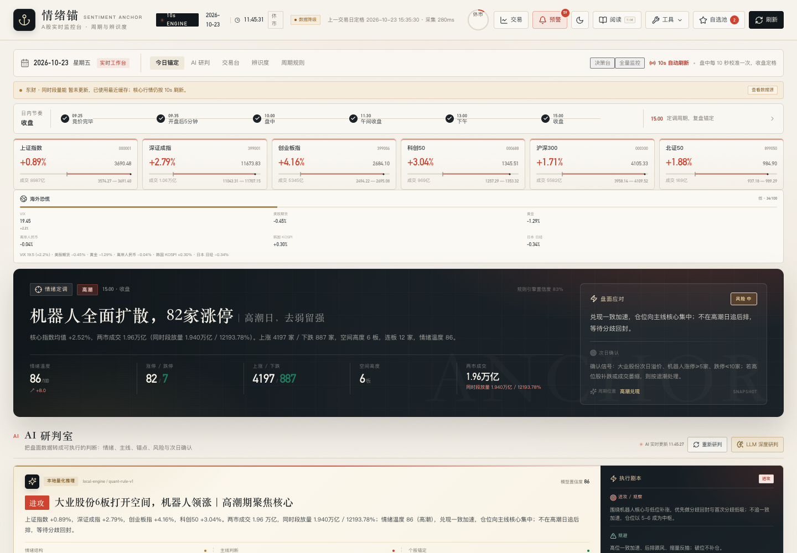
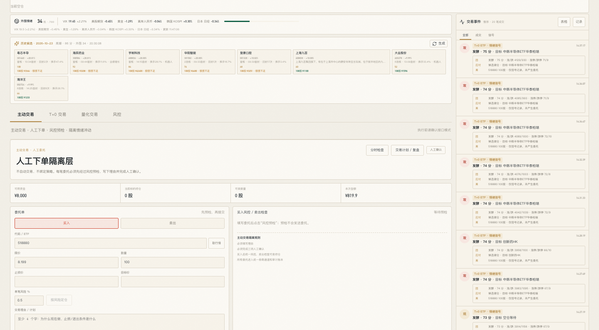
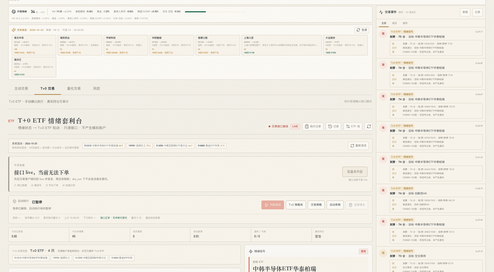
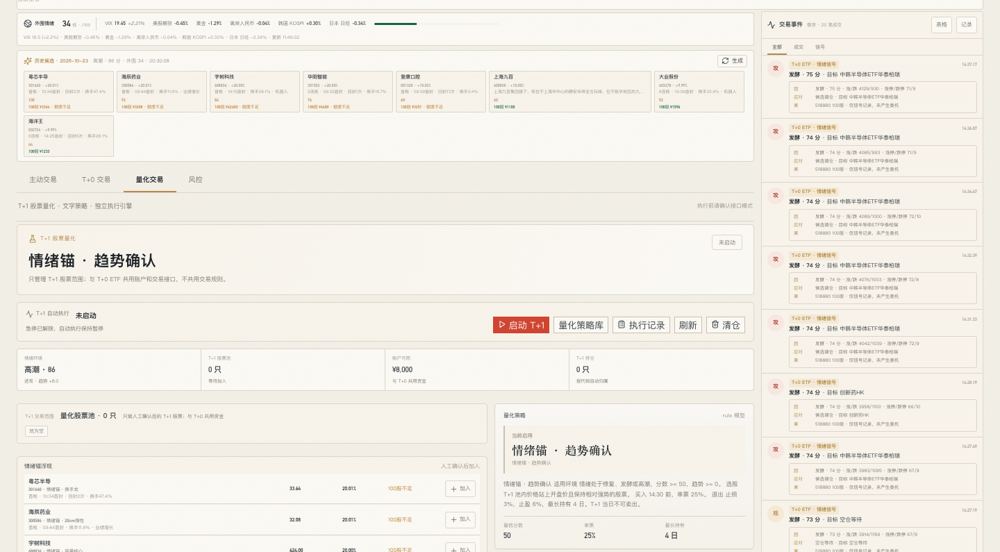
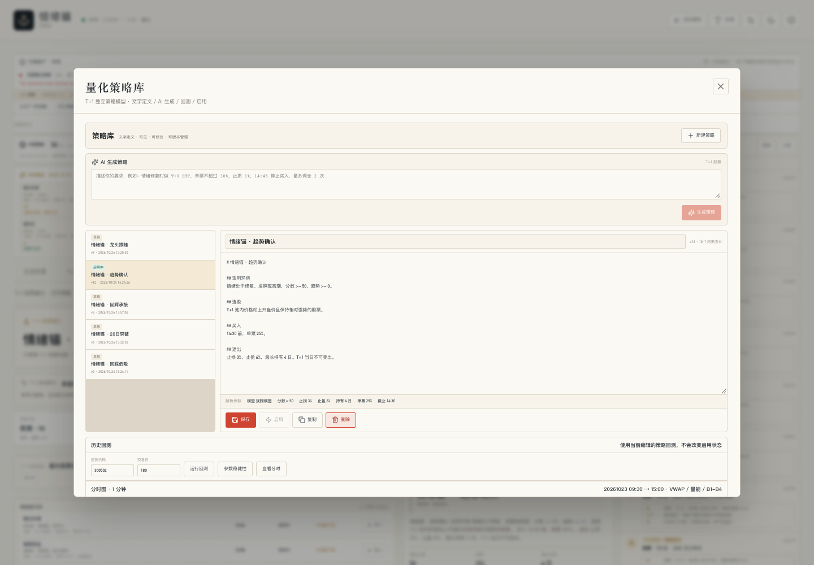
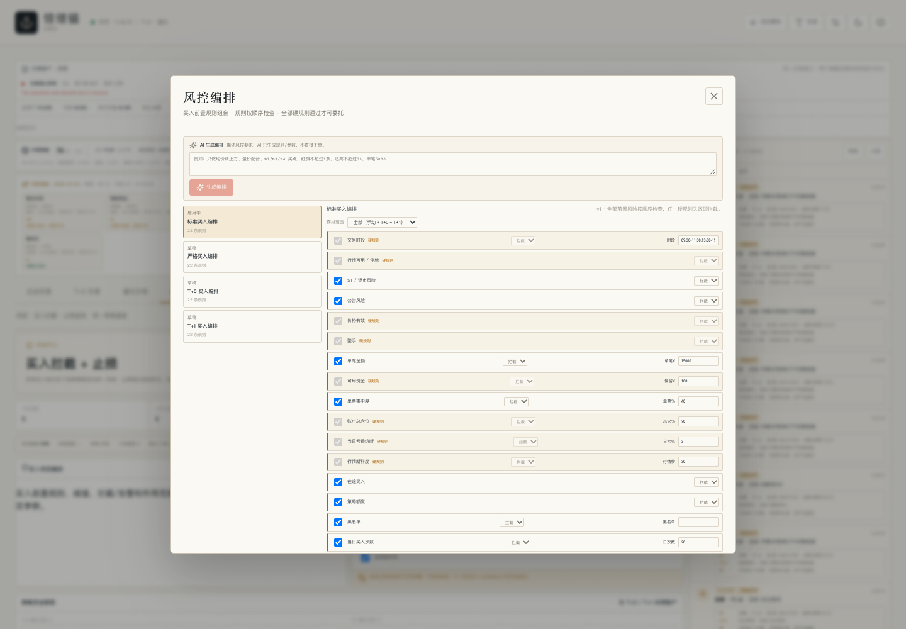
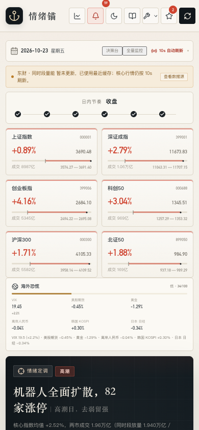
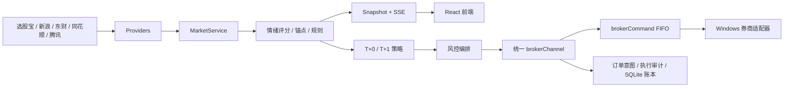

# SentimentAnchor · 情绪锚

A 股情绪监控 + T+0 ETF / T+1 股票交易研究终端。

仓库：<https://github.com/licc/SentimentAnchor>

> **研究/工程演示项目，不构成投资建议。**  
> Windows 适配器已完成查询 / dry_run 联调；真实资金报单、撤单和成交回读仍需按账户小额验证。  
> 仓库中的截图使用**本地演示数据**；不要使用真实账户截图发到公开仓库。
>
> **完整免责声明见 [DISCLAIMER.md](DISCLAIMER.md)。使用本项目即表示你已理解并接受相关风险。**



## 项目定位

```text
公开行情采集
  → 情绪评分 / 锚点 / 主线
  → 策略与回测
  → 风控编排
  → 统一券商队列
  → 账本 / 审计 / 复盘
```

这是一个**单操作者、单券商、小资金 A 股工作台**，不是机构级多策略平台，也不是无风险套利系统。

## 功能状态

| 模块 | 状态 | 说明 |
|---|---|---|
| 行情看板 / 情绪评分 | 可用 | 公开数据源，10 秒级刷新，SSE 推送 |
| 锚点 / 涨停池 / 周期日历 | 可用 | 动态计算，不使用写死股票 |
| 外围情绪 | 可用 | VIX、美股期货、黄金、CNH、韩国、日本 |
| 模拟交易 | 已移除 | 避免与真实交易混淆 |
| T+0 / T+1 共用账户 | 已联调 dry_run | 真实资金报单/撤单待小额验证 |
| 统一券商队列 / 订单意图 / 账本 | 代码可用 | 需要自备 Windows 券商适配器 |
| 风控编排 | 可用 | 22 条规则，硬规则不可关闭 |
| 止损 / 急停 / 日亏熔断 | 可用 | 卖出仍走统一券商通道 |
| T+1 策略库 / 日线回测 | 可用 | 费用、滑点、涨跌停、样本外、滚动窗口 |
| T+0 策略库 | 部分 | 有分时验证，无策略级历史回测 |
| 1 分钟分时 | 可用 | VWAP、量比、红旗、B1-B4/S1-S4 |
| 公司行为 | 部分 | 回测前复权；实盘账本入账未完成 |
| Point-in-time | 部分 | 部署后逐日积累，历史数据不足 |
| 多策略组合 | 未完成 | 当前为 T+0/T+1 双额度 + 逐股指定策略 |
| 实盘券商 | 已联调 dry_run | `thsapi/` 查询/健康/风控/台账已联调；真实报单待验证 |

## 截图

### 情绪锚


### 主动交易



### T+0



### T+1 量化



### 策略与分时



### 风控编排



### 移动端



## 架构



更详细的设计见 [架构文档](docs/ARCHITECTURE.md)。

## 使用文档

- [部署与操作指引](docs/DEPLOYMENT.md)（推荐先看：从零部署、启停、局域网、故障排查）
- [完整使用文档](docs/USAGE.md)
- [架构](docs/ARCHITECTURE.md)
- [API](docs/API.md)
- [验证与边界](docs/VERIFICATION.md)
- [更新记录](docs/CHANGELOG.md)（最近：2026-10-25 局域网访问与 OCR 识别修复）

## 快速开始

要求：

```text
Node.js >= 20.10
pnpm >= 11
```

安装：

```bash
pnpm install
cp .env.example .env
pnpm dev
```

一键启停（前端 + 后端 + 适配器，日志写到 `data\run\`）：

```powershell
powershell -ExecutionPolicy Bypass -File scripts\services.ps1 start
powershell -ExecutionPolicy Bypass -File scripts\services.ps1 status
powershell -ExecutionPolicy Bypass -File scripts\services.ps1 stop
```

完整流程（含 thsapi 虚拟环境、客户端登录、验收清单、故障排查）见
[部署与操作指引](docs/DEPLOYMENT.md)。

开发地址：

```text
前端：http://127.0.0.1:5173
后端：http://127.0.0.1:8787
```

需要**局域网访问**时：

```text
1. 把 .env 的 HOST 改为 0.0.0.0
2. 把 package.json 里 dev:web 的 --host 改为 0.0.0.0（vite.config.ts 的 server.host 同步改）
3. 防火墙放行 5173 / 8787 入站（建议限制为本地子网）
4. 对外暴露前务必设置 .env 的 APP_TOKEN，否则同网段任何人可打开看板并触发交易台操作
```

生产构建：

```bash
pnpm build
pnpm start
```

## 配置

复制 `.env.example` 后按需修改。**不要把 `.env` 提交到 Git。**

常用变量：

| 变量 | 默认 | 说明 |
|---|---|---|
| `HOST` | `127.0.0.1` | 监听地址 |
| `PORT` | `8787` | HTTP 端口 |
| `REFRESH_MS` | `10000` | 行情刷新间隔，最低 5000ms |
| `APP_TOKEN` | 空 | 可选访问口令；设置后启用登录 |
| `LLM_API_KEY` | 空 | 可选，OpenAI 兼容接口 Key |
| `LLM_BASE_URL` | DeepSeek 兼容地址 | LLM Base URL |
| `ETF_BROKER_URL` | `http://127.0.0.1:8888` | 券商适配器地址 |
| `ETF_BROKER_KEY` | 空 | 可选；为空不发送 `X-API-Key` |
| `ETF_MAX_ORDER_AMOUNT` | `50000` | 人工单笔金额上限 |

也可以在页面：

```text
系统设置 → 交易接口
```

修改券商地址、Key、超时和人工单笔上限。页面配置保存在 `data/runtime-config.json`，不会提交。

## 券商适配器

仓库包含 Windows 同花顺 GUI 适配器源码：`thsapi/thsapi-0.1.0-20261023/`。

Windows dry_run/查询链路已联调；真实资金报单仍需按账户小额验证。适配器提供：

```text
GET  /api/v1/health
GET  /api/v1/portfolio
GET  /api/v1/orders
GET  /api/v1/trades
POST /api/v1/orders
POST /api/v1/cancel
POST /api/v1/cancel-all
```

节点只通过统一 `brokerChannel` 调用，不允许策略直接下单。

详见 [thsapi 对接说明](docs/thsapi-integration.md) 和 [代码目录说明](docs/CODEBASE.md)。

## API

完整接口说明：

- [API 文档](docs/API.md)
- [数据与安全边界](docs/VERIFICATION.md)

主要入口：

```text
GET  /api/snapshot          行情快照
GET  /api/stream            SSE 实时推送
GET  /api/system/health     系统健康
GET  /api/risk/policies     风控编排
POST /api/manual/preflight  人工下单预检
POST /api/etf/order         统一委托提交
GET  /api/quant/backtest    T+1 日线回测
GET  /api/intraday/analysis 1 分钟分时分析
GET  /api/preopen           盘前候选
```

## 项目结构

```text
server/
  providers/       行情、公告、公司行为、分时数据源
  services/        市场、策略、回测、风控、执行、账本
  services/risk/   风控规则、策略、AI 草稿
src/
  components/      看板、交易台、策略库、风控、设置
  hooks/           SSE、行情、自动执行、账本
docs/
  ARCHITECTURE.md
  API.md
  VERIFICATION.md
  screenshots/
data/              本地运行数据（Git 忽略）
```

## 测试

```bash
pnpm test:core
pnpm test:state
pnpm test:broker
pnpm smoke
pnpm build
```

测试覆盖：

```text
持仓/行情异常清洗
订单状态机
下单/撤单/未知委托 mock
T+0 策略解析
公司行为前复权
风控参数与硬规则
```

## 数据与隐私

- `data/`、`.env*`、`dist/`、`thsapi/` 已在 `.gitignore` 中排除。
- 仓库不包含真实账户、委托、成交、持仓、API Key。
- 公开行情来自第三方接口，可能延迟、缺失或口径不同；以交易所和券商为准。
- 截图使用演示数据；发布前仍需自行检查是否含真实账户信息。

## 已知边界

```text
Windows 券商适配器已完成 dry_run/查询联调；真实资金报单、撤单、成交回读仍需账户验证
Point-in-time 历史股票池不足
完整退市/历史 ST/停牌数据未接入
实盘账本分红入账与成本调整未完成
同模块多策略并行未完成
T+0 策略级历史回测未完成
1 分钟历史仅最近 5 日 + 本地归档
```

## 开源协议

本项目使用 [MIT License](LICENSE)。

第三方数据接口、行情、交易软件和券商服务受各自协议约束；本项目不提供数据授权，也不对交易结果作保证。

## 贡献与安全

- [贡献指南](CONTRIBUTING.md)
- [安全策略](SECURITY.md)

## 免责声明

本项目仅用于技术研究和复盘，不构成投资建议。任何策略、回测、AI 输出和界面信号都可能错误；行情来自第三方公开接口，可能延迟、缺失或口径不一致。使用者需自行承担交易、资金和合规风险。

完整条款见 [DISCLAIMER.md](DISCLAIMER.md)。
