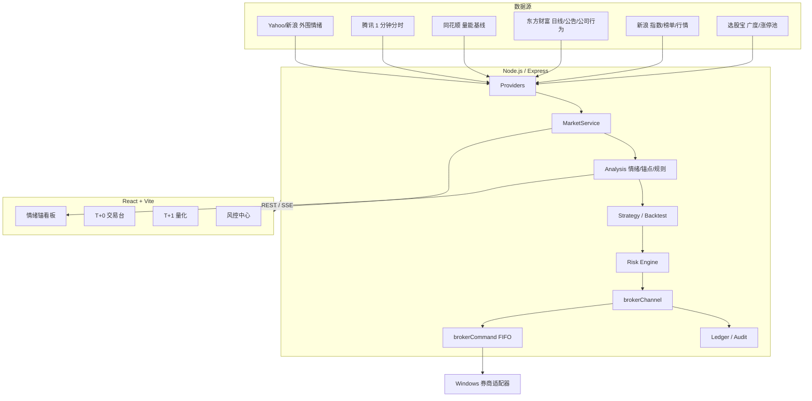

# 架构

## 总览

情绪锚是一个单进程 Node.js 服务 + React 前端。服务端负责行情聚合、情绪评分、策略、回测、风控和券商队列；前端通过 REST/SSE 展示和操作。



## 行情链路

1. Providers 统一超时、重试、GBK/JSON 解析。
2. `MarketService` 按 `REFRESH_MS` 聚合指数、广度、涨跌停、板块、外围情绪。
3. `analysis.ts` 计算情绪温度、阶段、风险、锚点和规则。
4. Snapshot 通过 SSE `/api/stream` 推送；断线由前端重连/兜底轮询。

## 情绪锚

```text
涨跌家数 + 涨跌停差 + 封板质量 + 空间高度 + 指数动量
→ score / stage / trend / risk
→ 9 个动态锚点
→ 主线、辨识度、周期规则
```

锚点只来自实时涨停/跌停池和榜单，不写死股票代码。

## T+0 / T+1

两个独立引擎共用：

```text
账户
持仓
券商接口
资金
订单意图
执行审计
SQLite 账本
```

不共用交易规则：

- T+0：ETF 情绪轮动，14:55 清仓约束。
- T+1：股票池、逐股策略、T+1 卖出限制、持有天数。

## 执行安全

```text
策略/手动
  → Risk Engine
  → 统一 brokerChannel
  → brokerCommand 单写 FIFO
  → 券商适配器
  → 订单查询/成交确认
  → ledger / execution audit
```

约束：

- 业务层不直接调用券商下单。
- `clientOrderId` 幂等，重复提交不重复下单。
- 未知委托先查持仓/委托，不盲目补单。
- 所有写操作串行，避免并发持仓状态错乱。
- 风控硬规则不可关闭。

## 风控

风控策略 = 有序规则集合：

```text
交易时段 / 行情可用
ST / 公告
价格 / 整手 / 单笔金额
现金 / 单票 / 总仓
日亏损 / 数据新鲜度
在途买入 / 策略额度
黑名单 / 日次数 / 重复委托
分时结构 / 量价 / 红旗 / 买点 / 追高
```

每条规则支持：

```text
enabled
severity: block | warn
params
```

硬规则（交易时段、行情、价格、整手、资金、总仓、日亏损、新鲜度、重复）不能关闭或降为 warn。

## 数据存储

```text
data/                  运行时数据，Git 忽略
  runtime-config.json  券商地址/超时/人工上限
  ledger.db            SQLite 账本
  pit/                 Point-in-time 快照
  intraday/            1 分钟分时归档
  preopen/             盘前候选
  risk-policies.json   风控编排
  quant-strategies.json
  t0-strategies.json
```

## 前端

```text
src/components/   看板、交易台、策略库、风控、设置、弹窗
src/hooks/        SSE、行情、自动执行、账本、配置
src/lib/          格式化、字体缩放、交易 PnL
src/styles.css    统一主题与响应式
```

页面：

```text
/        情绪锚看板
/jyt     交易台（主动交易 / T+0 / T+1 / 风控）
/docs    摸鱼页（可选）
```

## 部署

单进程部署：

```bash
pnpm build
pnpm start
```

Windows 券商适配器独立部署，只监听本机回环地址；Node 服务通过 `ETF_BROKER_URL` 访问。
